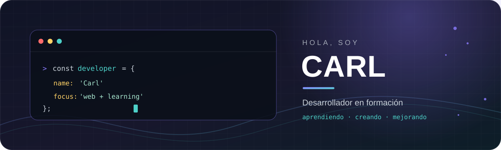

<!-- Banner vectorial del perfil -->

  

<h1 align="center">¡Hola! Soy Carl 👋</h1>

  <strong>Desarrollador en formación · Construyendo, aprendiendo y mejorando con cada proyecto</strong>

  
  
  

---

## 🧭 Sobre mí

- 🎓 Estoy aprendiendo desarrollo de software a través de proyectos y práctica constante.
- 🌐 Me interesa crear aplicaciones web útiles, claras y fáciles de usar.
- 🧩 Trabajo con interfaces web y exploro la programación con **Java** y **Python**.
- 🚀 Me gusta convertir ideas y ejercicios en proyectos que pueda seguir mejorando.

## ⭐ Proyecto destacado

### [AulaManager-CRUD](https://github.com/CarlX2324/AulaManager-CRUD)

Interfaz web para gestionar aulas: permite registrar, consultar, editar y eliminar información, conectándose a una API REST desarrollada con Spring Boot.

**Tecnologías del proyecto:** HTML · CSS · JavaScript · Spring Boot API

  

## 🛠️ Tecnologías y herramientas

  
  
  
  
  
  
  

## 📊 Mi actividad en GitHub

  
  

  

---

  <em>Gracias por visitar mi perfil. Siempre estoy aprendiendo algo nuevo ✨</em>

